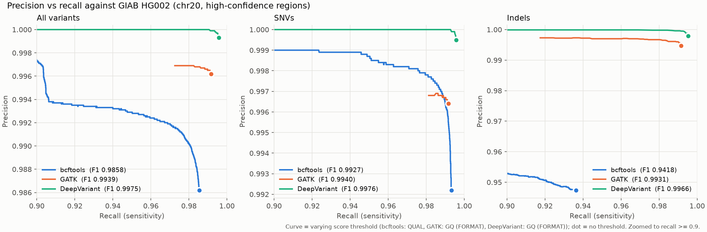
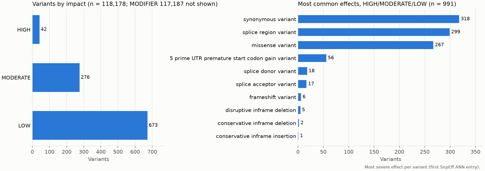

# giab-variant-pipeline

Minimal Snakemake pipeline for germline variant calling, benchmarked against the GIAB HG002 truth set.

**Steps:** fastp (QC/trimming) -> bwa mem -> samtools (sort, fixmate, markdup) -> GATK HaplotypeCaller -> bcftools filter -> rtg vcfeval.

**Extras:** SnpEff annotation of the filtered VCF, DeepVariant (Docker) on the same BAM, benchmarked the same way, and plots (`scripts/plot_*.py`, env `envs/plots.yaml`).

## Setup

1. Create and activate the conda environment (Snakemake 9 + tools):
   ```bash
   conda env create -f environment.yaml
   conda activate genomic-variants
   ```
   Use this env's `snakemake`, not an older system one (e.g. 7.x), which may wrongly
   flag finished steps (such as `bwa index`) for rerun.
2. Put the GRCh38 reference in `ref/` and the paired FASTQs under `$DATA` (see `config.yaml`).
3. Download the GIAB HG002 GRCh38 benchmark VCF (+ `.tbi`) and BED into `truth/`.
4. Edit `config.yaml` (paths, region, filter).

## Run

```bash
export DATA=/path/to/data          # raw reads are read from $DATA
snakemake -n --use-conda           # dry run
snakemake --use-conda --cores 8
snakemake --lint                   # lint
snakemake --dag | dot -Tpdf > dag.pdf   # rule graph
```

Requires the `DATA` environment variable and Docker (for DeepVariant).

Outputs:
- GATK benchmark: `results/eval/<sample>/summary.txt`
- DeepVariant benchmark: `results/eval_deepvariant/<sample>/summary.txt`
- SnpEff annotation: `results/annot/<sample>.snpeff.vcf.gz` (+ `.html` report)
- Plots: `results/plots/<sample>_precision_recall.png` (bcftools vs GATK vs DeepVariant,
  all variants / SNVs / indels) and `results/plots/<sample>_snpeff.png` (impact classes,
  most common effects)
- Reports with plots: `results/qc/<sample>_fastp.html`, `results/annot/<sample>.snpeff.html`
- Logs: `logs/<rule>/<sample>.log`

## Layout

- `Snakefile`: all rules, one per step
- `config.yaml`: paths, region, filter expression, sample sheet
- `envs/`: per-rule conda envs (`pipeline`, `gatk`, `annotation`, `plots`); DeepVariant runs via `docker run`
- `scripts/`: plotting scripts called by rules (`plot_benchmark.py`, `plot_snpeff.py`, shared `plot_style.py`)
- `figures/`: tracked copies of the plots and HTML reports linked below
- `ref/`, `data/`, `truth/`, `results/`, `logs/`: large or generated files, git-ignored

## Notes

- Reference contig names must match the truth set (`chr20` vs `20`).
- The SnpEff database (`snpeff_db`) is downloaded once into `snpeff_data_dir`.

## Results (HG002, chr20, GIAB v4.2.1 high-confidence regions)

| Caller | Filter | TP | FP | FN | Precision | Recall | F1 |
|---|---|---|---|---|---|---|---|
| bcftools | `QUAL<20 \|\| DP<10` | 81,384 | 1,140 | 1,205 | 0.9862 | 0.9854 | 0.9858 |
| GATK HaplotypeCaller | GATK hard filters without `MQ<40` | 81,903 | 316 | 686 | 0.9962 | 0.9917 | 0.9939 |
| DeepVariant 1.10.0 | PASS only | 82,230 | 59 | 359 | 0.9993 | 0.9957 | 0.9975 |

TP = true positives (baseline), FP = false positives, FN = false negatives; values from vcfeval
with no score threshold (`None` row of `summary.txt`).



### GATK filter tuning

All runs use the same BAM and HaplotypeCaller calls (no BQSR); only the `bcftools filter` expression changes.

| GATK filter | Precision | Recall | F1 |
|---|---|---|---|
| `QUAL<20 \|\| DP<10` (same as bcftools) | 0.9924 | 0.9938 | 0.9931 |
| GATK recommended hard filters | 0.9967 | 0.9873 | 0.9920 |
| Hard filters without `MQ<40` (current) | 0.9962 | 0.9917 | 0.9939 |

The SNV `MQ<40` term alone removed ~400 true SNVs on chr20, so it was dropped.

### Annotation (SnpEff, GRCh38.115)

118,178 variants annotated in the filtered GATK VCF. By putative impact: HIGH 42,
MODERATE 276, LOW 673, MODIFIER 117,187.



Figures are copied from `results/plots/` (generated by the `plot_benchmark` and `plot_snpeff` rules).
Full interactive reports (download and open in a browser; GitHub shows HTML as source):
[fastp QC report](figures/HG002_fastp.html) and [SnpEff annotation report](figures/HG002.snpeff.html).
